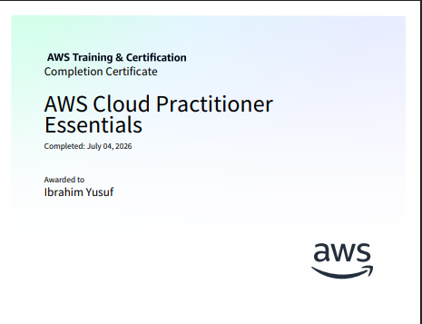

# AWS Cloud Practitioner Essentials

[AWS Skill Builder course page](https://skillbuilder.aws/learn/94T2BEN85A/aws-cloud-practitioner-essentials/8D79F3AVR7)

## Certificate

**Completed:** July 4, 2026  
**Awarded to:** Ibrahim Yusuf

## Course notes

[Read the AWS Cloud Practitioner Essentials notes](notes.md) — summaries of the course's cloud, compute, global infrastructure, networking, storage, databases, AI/ML and analytics, security, governance, pricing, migration, and Well-Architected topics.

> This is an AWS Skill Builder course completion certificate. It is not the AWS Certified Cloud Practitioner exam credential.
