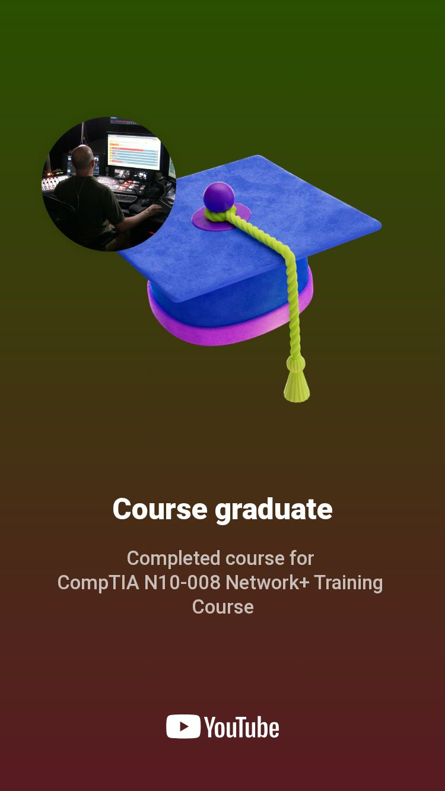

# CCNA and CompTIA Network+ Learning Notes

Notes from studying CCNA and CompTIA Network+, alongside the badges earned during this learning journey.

## Certifications and learning

- CCNA (Cisco Certified Network Associate)
- CompTIA Network+

These courses helped me understand how networks are designed, secured, and maintained.

## Video study resources

- [Professor Messer's CompTIA study playlists on YouTube](https://www.youtube.com/@professormesser/playlists) — includes CompTIA Network+ study material.
- [Jeremy's IT Lab on YouTube](https://www.youtube.com/@JeremysITLab) — CCNA videos, labs, and study resources.
- [Jeremy's IT Lab: CCNA 200-301, Day 1 — Network Devices](https://www.youtube.com/watch?v=H8W9oMNSuwo) — start of the free CCNA course.

These are study resources, not certification credentials.

## Badges and achievements

## Key skills

- Network fundamentals, including OSI and TCP/IP
- Routing and switching
- Network configuration
- Basic network security
- IP addressing and subnetting

The Cisco Packet Tracer lab write-ups and images are organized in [Cybersecurity Labs](https://github.com/Ibrahim7346/cybersecurity-labs).
